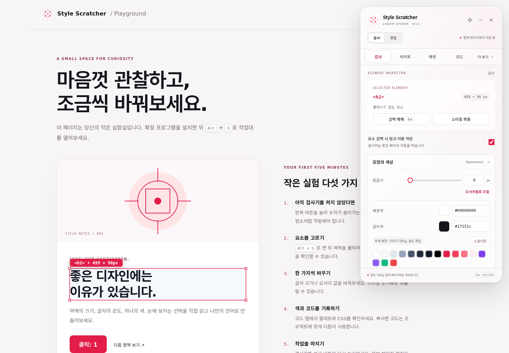

<div align="center">
  
  <h1>Style Scratcher</h1>
  <p><strong>웹을 읽는 눈, 디테일을 바꾸는 손.</strong></p>
  <p>브라우저 위에 펼치는 투명한 디자인 작업대.</p>
  <p><a href="LICENSE">Apache-2.0</a> · Manifest V3 · v4.1.0. preview · Runtime dependencies: 0</p>
</div>



**Style Scratcher**는 웹 페이지의 요소를 관찰하고 CSS를 조정하며, 발견한 색상과 코드를 다음 작업으로 가져오는 Chrome 확장 프로그램입니다. 필요할 때 켜고, 작업을 마치면 페이지에 대한 제어를 돌려줍니다.

[설치](#설치) · [기능](#무엇을-할-수-있나요) · [소개 페이지](website/index.html) · [브랜드](docs/BRAND.md) · [철학](docs/PHILOSOPHY.md) · [검증 기록](docs/VERIFICATION.md)

> **v4.1.0.은 개발 프리뷰입니다.** 이번 개선은 `chatgpt/refresh/integration` 브랜치에 있습니다. Chrome Web Store 등록이나 새 정식 릴리즈 배포를 뜻하지 않습니다. 아래 명령은 해당 프리뷰 소스를 받습니다.

## 설치

### 소스로 바로 설치

```sh
git clone --depth 1 --branch chatgpt/refresh/integration https://github.com/hslcrb/style-scrather.git
cd style-scrather
```

1. Chrome에서 `chrome://extensions`를 엽니다.
2. **개발자 모드**를 켭니다.
3. **압축해제된 확장 프로그램을 로드합니다**를 누릅니다.
4. `manifest.json`이 있는 **저장소 루트 폴더**를 선택합니다.
5. 일반 웹 페이지에서 확장 아이콘 또는 **Alt+S**로 검사기를 켭니다.

Git 없이 설치하려면 [프리뷰 소스 ZIP](https://github.com/hslcrb/style-scrather/archive/refs/heads/chatgpt/refresh/integration.zip)을 내려받아 압축을 풀고 같은 절차를 따르세요. 확장 실행에는 npm 설치나 서버가 필요하지 않습니다.

### 깔끔한 설치 패키지 만들기

Node.js 20 이상에서:

```sh
npm run build
```

`dist/style-scratcher/`는 바로 로드할 수 있는 확장 폴더입니다. ZIP과 SHA-256 체크섬도 `dist/`에 생성됩니다. 문서, 테스트, 개발 도구는 확장 ZIP에 포함하지 않습니다. 같은 소스에서는 같은 ZIP과 체크섬을 만듭니다.

## 무엇을 할 수 있나요?

| 작업 | 제공하는 도구 |
| --- | --- |
| 관찰하기 | 요소 선택, 크기와 간격, 박스 모델, 여러 단위, 그리드, 탭 순서 |
| 조정하기 | 모서리, 여백, 색, 글자, 이미지와 SVG, 로컬 DOM 편집 |
| 기록하기 | 색상 팔레트, CSS, Tailwind 클래스와 React JSX 초안 |
| 자세히 보기 | 폰트 정보, 문자 폭 측정·텍스트 윤곽, 모션 속도, 정밀 커서와 줌 |
| 비교하기 | 디바이스 프레임, 선택 요소의 인터랙션·그래픽 정보 |

### 이번 프리뷰의 변화

- **필요할 때 시작:** 팝업을 열거나 페이지를 로드하는 것만으로 검사 모드가 켜지지 않습니다.
- **정확한 상태:** 연결 확인, 실행 중, 대기, 제한 페이지, 실패를 구분합니다. 실패한 작업을 성공으로 표시하지 않습니다.
- **정돈된 작업대:** 크림슨 포인트와 리퀴드 글래스 표면, 핵심 탭과 보조 도구 메뉴, 키보드 조작과 작은 창 대응.
- **덜 그리는 오버레이:** 갱신을 애니메이션 프레임 단위로 묶고, 비활성 상태에서는 오버레이를 그리지 않습니다.
- **작업 종료 복원:** 줌·프리징 등 임시 검사 동작을 종료하고 이벤트 처리를 정리합니다. 사용자가 적용한 실제 페이지 편집은 새로고침으로 초기화할 수 있습니다.
- **검증 가능한 코드:** 실제 Manifest V3 브라우저 검사, 동작 회귀 테스트, 재현 가능한 패키징을 제공합니다.

## 다섯 분 사용법

1. **Alt+S**로 작업대를 엽니다. 선택 보호가 켜져 있으면 클릭은 페이지 이동 대신 요소 선택에 사용됩니다.
2. 제목이나 버튼을 클릭해 선택하고, 검사 탭에서 스타일을 읽습니다.
3. 여백이나 모서리 값을 바꿉니다. **스타일 초기화**로 선택 요소의 CSS를 복원할 수 있습니다.
4. 코드 탭에서 CSS·JSX 또는 색상 팔레트를 확인합니다.
5. 작업대의 닫기 버튼이나 **Alt+S**로 종료합니다.

편집 결과는 원본 웹사이트 서버나 프로젝트 파일에 저장되지 않습니다. 텍스트·이미지·DOM 수정까지 모두 되돌리려면 페이지를 새로고침하세요.

## 단축키

| 단축키 | 동작 |
| --- | --- |
| `Alt + S` | 검사기 켜기 / 끄기 |
| `Esc` | 선택 해제, 열린 보조 메뉴 닫기 |
| `Alt + E` | 검사 / 편집 모드 전환 |
| `Alt + G` | 그리드 |
| `Alt + C` | 정밀 커서 |
| `Alt + T` | 탭 순서 |
| `Alt + =`, `Alt + -`, `Alt + 0` | 확대, 축소, 원래 배율 |
| `Alt + F` | 검사 중 페이지 이벤트 프리징 |
| `Alt + U` | 검사 중 선택·컨텍스트 메뉴 제한 완화 |

입력 필드에 글을 쓰는 동안에는 페이지 검사 단축키가 입력을 가로채지 않습니다. Chrome의 전역 **Alt+S** 단축키는 `chrome://extensions/shortcuts`에서 조정합니다. 나머지 단축키는 작업대 설정에서 조정할 수 있습니다.

## 소개 페이지와 실습 페이지

```sh
npm start
```

- `http://127.0.0.1:3000/` — 반응형 소개 페이지. 예제의 색과 모서리를 직접 바꾸고 CSS를 복사할 수 있습니다.
- `http://127.0.0.1:3000/demo/` — 설치한 확장으로 검사·편집·클릭 복원을 확인하는 실습 페이지.
- `dist/site/` — `npm run build`로 생성하는 정적 소개 페이지 배포 폴더.

소개 페이지의 예제는 그 안에 있는 샘플만 편집합니다. 임의의 웹사이트를 검사하려면 확장을 설치해야 합니다. 배포 안내는 [개발 가이드](docs/DEVELOPMENT.md)를 참고하세요.

## 개발과 검증

```sh
npm ci
npm run check
npm test
npm run build
npx playwright install chromium
npm run test:browser
```

기본 테스트와 패키징은 Node 표준 라이브러리로 실행됩니다. Playwright는 실제 브라우저 테스트를 위한 **개발 전용** 의존성입니다. 결과와 비교 조건은 [검증 기록](docs/VERIFICATION.md)에 남깁니다.

## 저장소 구조

| 경로 | 역할 |
| --- | --- |
| `manifest.json` | 설치 진입점, 권한과 스크립트 순서 |
| `background/` | 브라우저 명령, 주입, 폰트 리소스 요청 |
| `content/` | 요소 검사, 편집, 오버레이와 기능별 엔진 |
| `content/components/`, `content/styles/` | Shadow DOM 작업대와 디자인 토큰 |
| `popup/` | 확장 팝업과 연결 상태 |
| `icons/` | 재현 가능한 로고·워드마크·아이콘 |
| `website/` | 의존성 없는 제품 소개 페이지 |
| `demo/` | 네트워크 의존성 없는 실습 페이지 |
| `scripts/` | 서버, 검사, 테스트 실행, 패키징, 로고 생성 |
| `test/` | 엔진·UI·통합 회귀 검사 |
| `docs/` | 아키텍처, 브랜드, 철학, 개인정보, 검증, 릴리즈 기록 |
| `.github/` | 이슈와 PR 템플릿 |

자세한 경계와 데이터 흐름은 [Architecture](docs/ARCHITECTURE.md)를 참고하세요.

## 지원 범위와 알려진 경계

데스크톱 Chrome/Chromium을 대상으로 합니다. 브라우저 내부 페이지와 웹스토어에는 Chrome이 주입을 제한합니다. 교차 출처 iframe, 닫힌 Shadow DOM, 읽기가 제한된 스타일시트와 폰트는 접근할 수 없는 경우가 있습니다. 디바이스 프레임은 실제 기기 에뮬레이터가 아니며, 코드 추출은 프로젝트 구조와 상태 로직을 복원하지 않습니다.

실제 검증 환경과 아직 확인하지 못한 환경을 [검증 기록](docs/VERIFICATION.md)에 구분합니다. 재현할 수 있는 오류는 [이슈](https://github.com/hslcrb/style-scrather/issues/new/choose)로 알려주세요.

## 함께 만들기

[기여 가이드](CONTRIBUTING.md) · [커뮤니티 기준](CODE_OF_CONDUCT.md) · [보안 제보](SECURITY.md) · [개인정보와 권한](docs/PRIVACY.md) · [변경 이력](CHANGELOG.md)

Copyright 2024–2026 Rheehose (Rhee Creative) / Hose Rhee (이호세). [Apache License 2.0](LICENSE).

Style Scratcher는 독립적인 오픈소스 프로젝트입니다. Chrome, Figma, Tailwind와 React는 각 소유자의 이름이며 공식 제휴를 뜻하지 않습니다.
