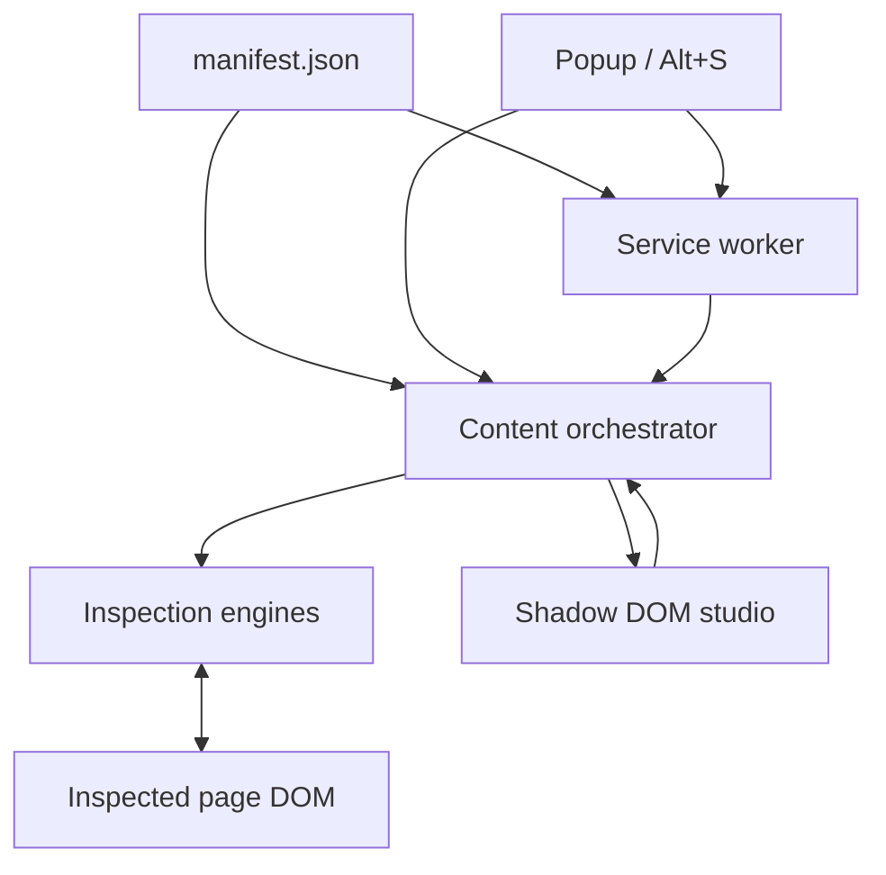

# Architecture

Style Scratcher is a Manifest V3 extension made from browser JavaScript, HTML and CSS. The installation root remains the repository root. The introduction is a separate static website; it does not need or imitate extension privileges.

## Runtime boundaries

| Boundary | Responsibility | Main files |
| --- | --- | --- |
| Manifest | Permissions, ordered content script list, browser command, packaged assets | `manifest.json` |
| Service worker | Toggle command, missing-receiver injection, bounded font resource fetch | `background/service-worker.js` |
| Popup | Identify current tab, read state, explicit activation, honest loading/error feedback | `popup/popup.js` |
| Orchestrator | Lazy initialization, message routing, selection, active/inactive lifecycle | `content/content.js` |
| Overlay | Coalesce invalidation into a frame, draw dimensions/grid/selection | `content/overlay-canvas.js` |
| Editing | Local CSS restoration, DOM actions, text/image/SVG changes | `style-tweaker.js`, `mode-manager.js`, `asset-editor.js` |
| Visual tools | Units, zoom, cursor, motion, device frame, tab sequence | Individual modules in `content/` |
| Extraction | Palette, font data, CSS, Tailwind, JSX starting points | Individual modules in `content/` |
| Studio | Selection feedback, tool panels, input state, keyboard navigation | `content/components/floating-dock.js` |
| Presentation | Shadow-contained tokens and studio styling | `content/styles/shadow-styles.css` |

## Activation lifecycle

The manifest loads the ordered scripts in an isolated content world. Loading scripts does not automatically initialize the studio. `GET_STATE` is a read; it does not turn inspection on. Explicit activation creates the host, Shadow DOM, engines and studio once. Subsequent activation reuses the same instance.

When a page has no message receiver, the popup or service worker uses the manifest's script list to inject and await it. Repeated injection must leave one host and one set of listeners. Module registration guards protect class definitions from duplicate evaluation.

On exit, inspection listeners and temporary page modes are stopped or reset. The studio becomes hidden and the overlay stops drawing. User-authored CSS/text/DOM edits are a separate category: CSS can be reset with its control; refreshing the page restores the original page content.

## Messages

| Message | Direction | Result |
| --- | --- | --- |
| `GET_STATE` | Popup → content | Current active/grid state |
| `TOGGLE_SCRATCHER` | Popup or command → content | Confirmed active/grid state |
| `TOGGLE_GRID` | Popup → content | Updated grid and active state |
| `OPEN_TAB` | Popup → content | Open a tool panel and report success |
| `FETCH_FONT_BUFFER` | Content → worker | Bounded font data URL or actionable error |
| `GET_STATUS` | Extension context → worker | Machine/display version |

Chrome content scripts and service workers do not share DOM access. The font fetcher uses worker-compatible byte conversion; it must not use `FileReader`, which is a window API. The popup waits for confirmed responses rather than optimistically inventing an active state.

## Performance policy

- Keep the inactive path small. No studio host is created until requested.
- Invalidate the overlay on changed inputs; coalesce rapid calls with `requestAnimationFrame`.
- Paint only while active. Never turn a recursive animation loop into a background poll.
- Bound DOM/font work and yield to the browser during long scans.
- Cache work whose inputs have not changed and expose incomplete scan results accurately.
- Measure actual paint work as well as event count. The pointer-burst benchmark is not a claim about total website performance.

## Packaging and website

`scripts/build.js` collects only runtime asset directories plus `manifest.json` and `LICENSE`. It checks manifest-referenced files, rejects symlinks and produces an unpacked folder, deterministic ZIP and SHA-256 digest. ZIP timestamps are fixed at 1980-01-01 so file modification times do not affect the result.

The website is copied to `dist/site/` with its local icon assets. It can be hosted on a static host without Node, extension code or private keys. No runtime framework is involved in either product surface.

## Known boundaries

The extension is not DevTools. It cannot retrieve arbitrary page-world JavaScript listeners from its isolated world, reconstruct a full React application from rendered HTML, guarantee access to protected stylesheets or fonts, or turn a device frame into a real mobile browser. UI copy and documentation should make those boundaries clear.

## References

- [Chrome content scripts and isolated worlds](https://developer.chrome.com/docs/extensions/develop/concepts/content-scripts)
- [Extension service worker lifecycle](https://developer.chrome.com/docs/extensions/develop/concepts/service-workers/lifecycle)
- [Playwright extension testing](https://playwright.dev/docs/chrome-extensions)
